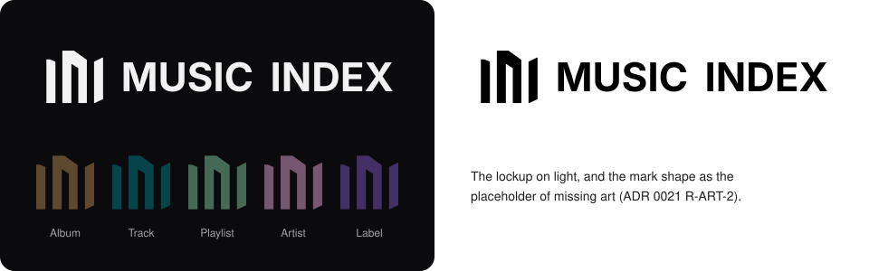
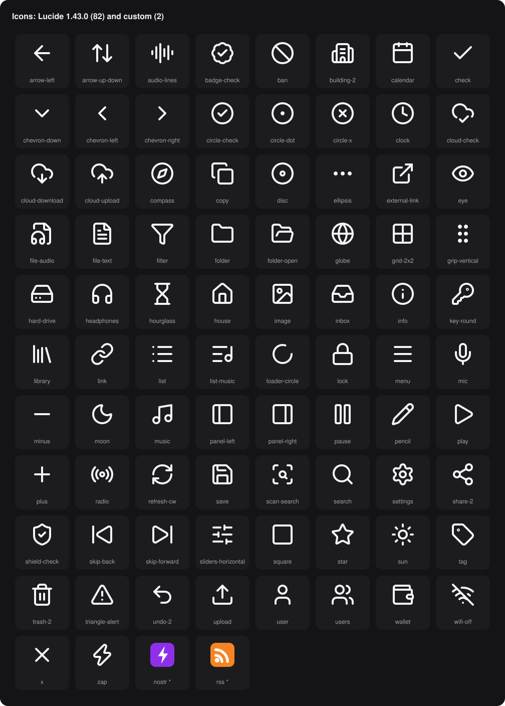

# musicindex-assets

The shared assets of the Music Index apps: musicindex.org,
musicindex-studio and v4vmm.





| Folder | Contents | License |
| --- | --- | --- |
| `brand/` | The logo mark, the mark shape, the lockups, the favicons and the brand pack | All rights reserved (`LICENSE`) |
| `fonts/figtree/` | Figtree: two `woff2` subsets for the web apps, four `ttf` weights for v4vmm | SIL Open Font License 1.1 (`fonts/figtree/OFL.txt`) |
| `icons/lucide/` | The Lucide 1.43.0 icons that the apps use | ISC, and MIT for the icons from Feather (`icons/lucide/LICENSE-LUCIDE`) |
| `icons/custom/` | Icons that Lucide does not have: the RSS and Nostr badges | All rights reserved (`LICENSE`) |
| `tokens/tokens.json` | The colors, the shapes, the font and the icon set of the apps | All rights reserved (`LICENSE`) |
| `manifest.json` | The SHA-256 and the license of each file | All rights reserved (`LICENSE`) |

musicindex owns the rules for these assets: ADR 0003, ADR 0012, ADR 0020,
ADR 0021 and ADR 0022 of the musicindex repository. A change of a value or a
file needs a decision there first.

## How An App Uses The Assets

Each app keeps copies of the files that it needs. Copy a file from this
repository. Do not change the copy.

Use these commands to check the copies:

```sh
python3 scripts/check.py verify
python3 scripts/check.py compare ../musicindex-studio/crates/api/ui/assets
```

`verify` compares the files of this repository with `manifest.json`.
`compare` finds each file in the given folder that has the name of an asset.
It exits with 1 when the bytes are different.

## Previews

GitHub shows an SVG file at the size that the file states, and it draws
`currentColor` as black. A Lucide icon is 24 px and uses `currentColor`, so
the icon files look small on GitHub, and almost invisible on its dark theme.
The apps need the files as they are.

`previews/` holds two sheets that show the assets larger, on their own
background. They are not assets. Run `python3 scripts/preview.py` after each
change of an icon or a brand file.

## Changed Lucide Icons

You can change a Lucide icon. The ISC and MIT licenses permit it, but the
notice in `icons/lucide/LICENSE-LUCIDE` must stay with the files. The change
itself is all rights reserved (`LICENSE`).

- Keep a changed icon in `icons/lucide/` with its Lucide name.
- Record the change in `icons/CHANGES.md`: the icon, the change and the
  reason.
- A new icon that Lucide does not have goes in `icons/custom/`.
